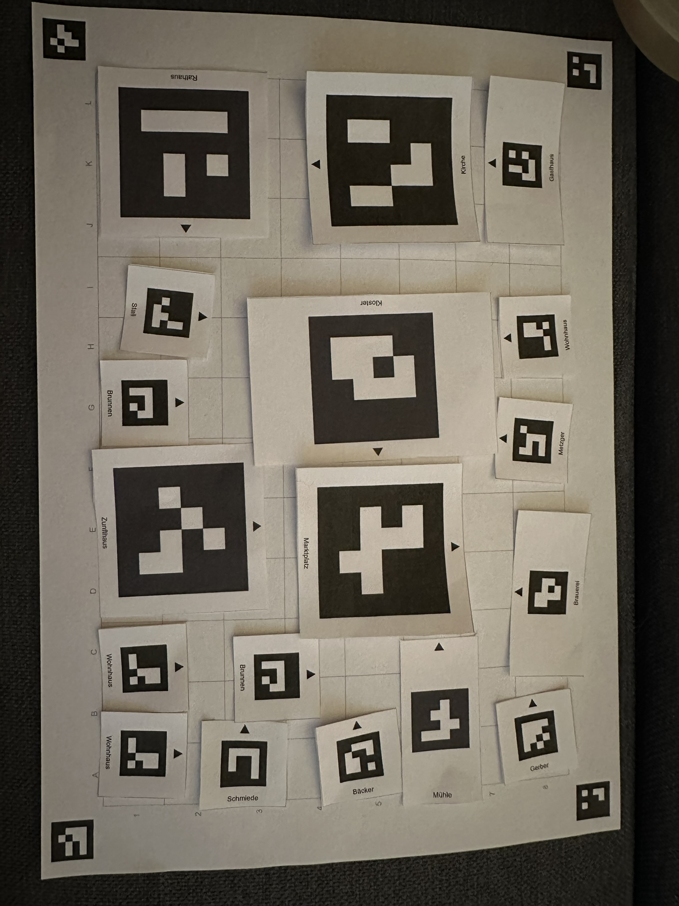
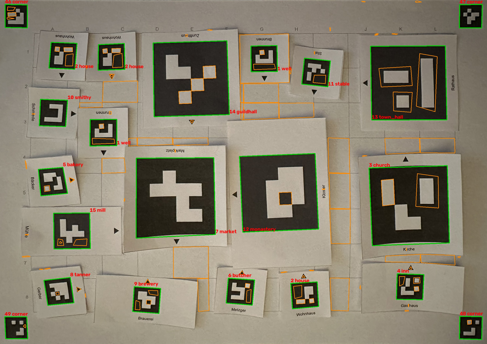

# Mittelalterliche Stadt – City Project

Aus gelegten Gebäudekärtchen wird eine begehbare 3D-Stadt: Schülerinnen und Schüler
ordnen Kärtchen mit ArUco-Markern auf einem Rasterblatt an. Die Lehreroberfläche
wertet ein Foto aus und öffnet die erkannte Stadt in Godot.

Das Projekt ist für den lokalen Unterrichtseinsatz vorgesehen. Nach Installation
der Entwicklungswerkzeuge und Abhängigkeiten funktioniert der getestete Ablauf
auch ohne Internetverbindung.

## Aktueller Stand

Dokumentationsstand: 16. November 2026 · Anwendung: `0.3.0-dev`.

Die Python-Entwicklungsfassung mit Demo-Auswahl wurde vom Projektbetreiber auf
Windows getestet, einschließlich eines frischen GitHub-ZIP-Downloads. Ein
eigenständiges Windows-EXE-Paket ist noch nicht erstellt und abgenommen.

Bestätigt wurden:

- Erkennung eigener Fotos und der drei mitgelieferten Beispielstädte.
- Kontrollbilder, Überlappungshinweise und Fehlerbehandlung bei fehlenden Eckmarkern.
- Verwerfen alter Ergebnisse beim Wechsel der Eingabe.
- Direkter 3D-Start vorbereiteter Demos und neue Erkennung von Demo-Fotos.
- Rückkehr zur geöffneten Lehreroberfläche nach Esc im Viewer.
- Offlinebetrieb und korrekte Gebäude, Farben und Texturen nach Godot-Erstimport.
- Erfolgreiche Backendtests, Demotests und Prüfung der Beispielsätze.

Diese Rückmeldungen sind Funktionstests, keine Zusicherung für sämtliche
Windows-Konfigurationen oder ein bereits fertiggestelltes Unterrichtspaket.

## So kann eine Stadt aussehen



Ein mitgeliefertes Foto: Gebäudekärtchen liegen auf dem gedruckten Raster.



Das Kontrollbild dient zum Prüfen der erkannten Anordnung. Bitte die Zuordnung von
Foto und Ergebnis auch bei Änderungen an Beispielsätzen beibehalten.

Weitere vollständige Beispiele liegen unter `examples/city03/` und
`examples/city04/`. Demonstrationsmedien liegen zusätzlich unter `examples/video/`.
Historische Videos können eine ältere Darstellung zeigen; maßgeblich ist die
aktuelle interaktive Demo. Eine Video-Schaltfläche ist derzeit nicht implementiert.

## Ohne Ausdruck ausprobieren

1. Anwendung wie unten beschrieben einrichten und starten.
2. Unter „Demo ausprobieren“ eine der drei Beispielstädte auswählen.
3. „Demo direkt in 3D“ öffnet vorbereitete Stadtdaten ohne neue Erkennung.
4. „Beispielfoto erkennen“ wertet das Foto tatsächlich neu aus.

Die Oberfläche kennzeichnet vorbereitete und neu erkannte Ergebnisse getrennt.
Beispiele werden nicht überschrieben. Bei einem Konflikt zwischen Demo-Katalog und
aktivem Viewer-Katalog wird der 3D-Start gesperrt, statt Daten stillschweigend auszutauschen.

## Schnellstart der Entwicklungsfassung unter Windows

Benötigt werden:

- Python mit Tk-Unterstützung (`tkinter`) und `pip`.
- Die Pakete aus `requirements-teacher.txt` einschließlich der Basisanforderungen.
- Eine Godot-Editor-/Engine-Programmdatei. Getestet wurde Godot 4.7.2 für Windows.
- Das vollständige Projekt einschließlich Modelle, Texturen und Beispieldaten.

Das Repository kann über GitHub → Code → Download ZIP bezogen werden. Git ist für
diesen Einrichtungsweg nicht erforderlich. ZIP vollständig entpacken und PowerShell
im Projektstamm öffnen.

### 1. Python-Abhängigkeiten installieren

```powershell
python -m pip install -r requirements-teacher.txt
```

Für Installation und Downloads kann eine Internetverbindung nötig sein. Die
anschließende Fotoverarbeitung und die Demos erfolgen lokal.

### 2. Godot-Erstimport durchführen

Im folgenden Befehl den Platzhalter durch den tatsächlichen Pfad zur Godot-EXE ersetzen:

```powershell
$Godot = "C:\Pfad\zu\Godot_v4.7.2-stable_win64.exe"
& $Godot --headless --path ".\cityviewer" --import
```

Auf das Ende des Importlaufs warten. Dieser Schritt ist bei einem frischen Download
wichtig: Der Importcache unter `cityviewer/.godot/` ist nicht Teil des Repositorys.
Nicht den Cache aus einem anderen Arbeitsordner kopieren und nicht pauschal
`.import`- oder `.uid`-Dateien löschen.

### 3. Prüfungen ausführen

```powershell
python test_teacher_backend.py
python test_teacher_demo.py
python check_demo_examples.py
```

Diese Prüfungen ersetzen weder den Godot-Erstimport noch die Sichtprüfung der 3D-Stadt.

### 4. Oberfläche starten

```powershell
python teacher_app.py
```

Alternativ `Start_Lehreroberflaeche.bat` doppelklicken. Falls nötig über
„Godot auswählen …“ einmal die Godot-Programmdatei auswählen, nicht `project.godot`.
Godot darf außerhalb des Projektordners installiert bzw. abgelegt sein.

## Eigene Städte auswerten

1. Zum Layout passende Raster- und Gebäudekärtchen verwenden.
2. Blatt mit allen vier sichtbaren Eckmarkern fotografieren.
3. „Bild auswählen …“ und danach „Stadt erkennen“ drücken.
4. Kontrollbild, Anzahl, Lage und Türseiten prüfen; Warnungen beachten.
5. „3D-Stadt öffnen“ drücken.

In 3D: WASD/Pfeile bewegen, Maus zum Umsehen, V wechselt die Ansicht, Esc schließt
den Viewer und führt zur weiterhin geöffneten Lehreroberfläche zurück.

## Projektbereiche

| Bereich | Zweck |
|---|---|
| `teacher_app.py` | Lehreroberfläche |
| `teacher_backend.py` | Adapter für Erkennung und Viewer |
| `teacher_demo.py` | Demo-Liste, Sitzungen und zusätzliche Prüfungen |
| `scripts/` | Erkennung, Druckerzeugung und Hilfsmodule |
| `settings/` | Bearbeitbare Einstellungen und Gebäudedefinitionen |
| `cityviewer/` | Godot-Projekt mit Modellen, Szenen und Skripten |
| `examples/` | Freigegebene Demos und Anschauungsmaterial |
| `output/` | Erzeugte Druckvorlagen, Layout und Scanner-Katalog |
| `scanresult/` | Standardausgabe des direkten Scanneraufrufs, nicht der GUI-Sitzungen |
| `docs_development/` | Entwicklungsnotizen; kein erforderlicher Programmstartschritt |

Historische Patches und Sicherungsordner sind keine Installationsvoraussetzung.
Ein frischer Download soll bereits den aktuellen Quellstand enthalten.

## Anleitungen

- [Anleitung für Lehrkräfte](Readme.Teacher.md)
- [Entwicklerdokumentation](Readme.Dev.md)
- [Drittanbieter-Inhalte und Lizenzstatus](THIRD_PARTY_NOTICES.md)
- [Bedienungsnotizen](controls.md)

## Modelle und Lizenzstatus

Die verwendeten Modellressourcen stammen laut Projektangabe aus der kostenlosen
Ausgabe des **Medieval Village MegaKit** von **Quaternius**. Die offizielle
[Paketwebseite](https://quaternius.com/packs/medievalvillagemegakit.html) weist CC0 aus.
Details und offene Lizenzarbeiten stehen in `THIRD_PARTY_NOTICES.md`.

Diese CC0-Angabe betrifft die betreffenden Modellressourcen, nicht automatisch den
eigenen Anwendungscode oder sämtliche Bibliotheken. Eine ausdrückliche Lizenz für
den eigenen Code wird mit dieser Dokumentation nicht festgelegt.

## Nächste Entwicklungsschritte

- Lizenz- und Hinweistexte für tatsächlich gebündelte Softwareversionen vervollständigen.
- Verpackte Erkennung und eigenständigen Godot-Viewer integrieren.
- Reproduzierbaren Windows-Build mit Demos und Daten erstellen.
- Paket ohne separat installiertes Python und ohne Godot-Editor testen.

Die aktuelle Python-Fassung benötigt weiterhin die oben genannten Entwicklungswerkzeuge.
