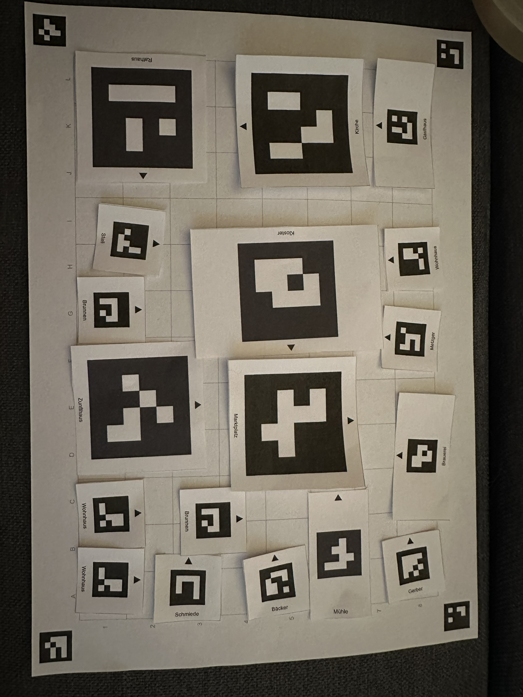
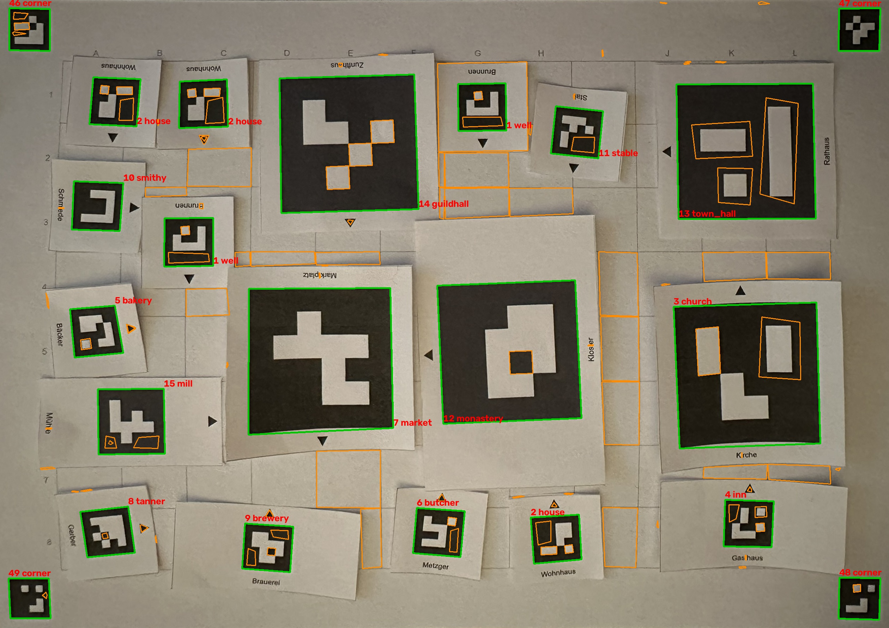

# Anleitung für Lehrkräfte

Dokumentationsstand: 16. November 2026 · Anwendung: `0.3.0-dev`.

## Was die Anwendung macht

Aus einem Foto gelegter Gebäudekärtchen entsteht eine begehbare mittelalterliche
3D-Stadt. Die Erkennung und Darstellung laufen lokal. Mit den mitgelieferten Demos
können Sie das Prinzip ohne Ausdrucke und ohne eigene Fotos ausprobieren.

Diese Anleitung beschreibt die getestete Python-Entwicklungsfassung. Ein fertiges
Windows-Paket ohne Python-Installation und ohne Godot-Auswahl ist noch in Vorbereitung.

## Einmalige Einrichtung

Wenn die Anwendung bereits eingerichtet wurde, direkt mit „Starten“ fortfahren.
Für die Einrichtung werden Python mit Tk, die Python-Bibliotheken und Godot benötigt.
Sie kann durch die Projektbetreuung vorgenommen werden.

Im vollständig entpackten Projektordner PowerShell öffnen:

```powershell
python -m pip install -r requirements-teacher.txt
```

Danach einmal die Modelle durch Godot importieren lassen. Den Pfad anpassen:

```powershell
$Godot = "C:\Pfad\zu\Godot_v4.7.2-stable_win64.exe"
& $Godot --headless --path ".\cityviewer" --import
```

Warten, bis der Vorgang abgeschlossen ist. Falls dabei Fehler erscheinen, zunächst
die Projektbetreuung verständigen. Für Installation/Downloads kann Internet nötig
sein; nach vollständiger Einrichtung funktioniert der getestete Ablauf offline.

## Starten

`Start_Lehreroberflaeche.bat` doppelklicken. Alternativ:

```powershell
python teacher_app.py
```

Falls nötig „Godot auswählen …“ drücken und die tatsächliche Godot-Programmdatei
wählen. Nicht `project.godot` auswählen. Die Auswahl wird für das Benutzerkonto
gespeichert und muss nach Verschieben/Löschen der Godot-EXE gegebenenfalls erneuert werden.

## 1. Zuerst eine Demo ausprobieren

1. Oben bei „Demo ausprobieren“ Beispielstadt 02, 03 oder 04 wählen.
2. Das zugehörige Foto wird angezeigt.
3. Eine der beiden Möglichkeiten wählen:

| Schaltfläche | Bedeutung |
|---|---|
| „Beispielfoto erkennen“ | Das Foto wird jetzt tatsächlich neu ausgewertet. |
| „Demo direkt in 3D“ | Eine vorbereitete Stadt wird ohne neue Erkennung geöffnet. |

Nach neuer Erkennung erst das Kontrollbild ansehen, dann „3D-Stadt öffnen“ drücken.
Bei Warnungen wird vor dem 3D-Start eine Bestätigung verlangt.

Die Kennzeichnung unter der Demo-Auswahl unterscheidet vorbereitete Ergebnisse von
einer neuen Erkennung. Die mitgelieferten Beispiele werden nicht verändert.



*Beispiel: So kann ein gelegtes Stadtblatt aussehen.*



*Beispiel: Kontrollansicht zum Vergleich mit den gelegten Kärtchen.*

## 2. Eigene Stadt auswerten

### Vorbereiten und fotografieren

- Die zum eingerichteten Layout passenden Raster- und Gebäudekärtchen verwenden.
- Kärtchen vollständig innerhalb des Rasters auslegen, sofern keine absichtliche
  Fehlerdemonstration vorgesehen ist.
- Alle vier Eckmarker frei und sichtbar lassen.
- Möglichst scharf, gleichmäßig beleuchtet und ohne starke Spiegelungen fotografieren.
- Wenn möglich nur das Blatt aufnehmen, keine Personen oder Schülernamen.

Die Anwendung kann ein Foto auswerten; eine Kamerasteuerung ist derzeit nicht Teil
der Oberfläche. Das Foto muss als lokale Bilddatei vorliegen.

### Foto laden und erkennen

1. „Bild auswählen …“ drücken und das Foto auswählen.
2. Vorschau kontrollieren.
3. „Stadt erkennen“ drücken und warten.
4. Nach Abschluss das Kontrollbild und die Hinweise prüfen.
5. „3D-Stadt öffnen“ drücken.

Während Erkennung und Viewerbetrieb sind Auswahl- und Startschaltflächen gesperrt.
Beim Wechsel zu einem anderen Foto oder einer anderen Demo wird das vorherige
aktive Ergebnis verworfen.

### Kontrollbild richtig prüfen

Vergleichen Sie mit dem gelegten Blatt:

- Wurden alle erwarteten Gebäude erkannt?
- Stimmen Lage und Grundfläche?
- Stimmen Türseiten und Ausrichtung?
- Gibt es Überlappungen oder Kärtchen außerhalb des Rasters?

„Keine Warnungen“ bedeutet nicht, dass garantiert jedes Kärtchen erkannt wurde.
Bei Fehlern möglichst die Anordnung oder das Foto korrigieren und erneut erkennen.

## 3. Vorschau und Ergebnisse

Das Auswahlfeld unten wechselt zwischen:

| Anzeige | Inhalt |
|---|---|
| `Originalfoto` | Ausgewähltes unverändertes Foto |
| `control.jpg` | Foto mit eingezeichneten Erkennungen |
| `rectified.jpg` | Entzerrte Kontrollansicht |

Ein Doppelklick in die Vorschau öffnet bei vorhandenem Ergebnis das entzerrte
Kontrollbild im externen Bildbetrachter. `rectified_raw.jpg` liegt zusätzlich im
Ergebnisordner; es ist die entzerrte Ansicht ohne Beschriftungen.

„Ergebnisordner“ öffnet die zugehörige Sitzung. „Protokoll“ öffnet das
Erkennungsprotokoll `detect.log`; nach einem 3D-Start liegt im Ergebnisordner
zusätzlich `viewer.log`.

## 4. In der 3D-Stadt

| Taste / Eingabe | Funktion |
|---|---|
| WASD oder Pfeiltasten | Bewegen |
| Maus | Im Rundgang umsehen |
| Umschalt | Im Rundgang schneller bewegen |
| V | Rundgang und Vogelperspektive wechseln |
| Mausrad | In der Vogelperspektive zoomen |
| Pos1 / Home | In der Vogelperspektive die ganze Stadt einpassen |
| F2 | Gebäudenamen ein-/ausblenden |
| F3 | Bildratenanzeige ein-/ausblenden |
| Esc | Viewer schließen; Lehreroberfläche bleibt geöffnet |

Für diese Bedienung werden derzeit Tastatur und Maus vorausgesetzt. Eine vollständig
auf Touch ausgelegte Steuerung ist nicht als fertige Funktion dokumentiert.

## 5. Häufige Probleme

| Problem | Vorgehen |
|---|---|
| Eckmarker fehlen | Das gesamte Blatt mit allen vier Eckmarkern neu fotografieren. |
| Keine Gebäude erkannt | Schärfe, Abstand und Sichtbarkeit der Marker prüfen. |
| Überlappung gemeldet | Anordnung im Kontrollbild prüfen, möglichst korrigieren und neu erkennen. |
| Demo fehlt in der Auswahl | Dateisatz ist möglicherweise unvollständig; angezeigte Demo-Hinweise weitergeben. |
| Katalogkonflikt | Projektbetreuung informieren; Katalogdateien nicht selbst austauschen. |
| Nur Farbblöcke statt Gebäude | Bei frischem Download zuerst Godot-Erstimport prüfen lassen. |
| Strukturen da, Texturen falsch | Importausgabe und vollständige Texturdateien durch Projektbetreuung prüfen lassen. |
| Godot nicht gefunden | Richtige Programmdatei erneut auswählen. |
| `layout.json` fehlt | Projektstand vervollständigen lassen; nicht auf Verdacht Druckvorlagen neu erzeugen. |

Für technische Rückfragen die konkrete Meldung, die gewählte Demo bzw. das Foto
und die Version notieren. Relevante Protokolle liegen unter „Ergebnisordner“.

## 6. Druckvorlagen

Die aktuellen Druckdateien liegen unter:

- [Rasterblatt](output/print/grid_sheet.pdf)
- [Gebäudekärtchen](output/print/cards.pdf)

Beim Drucken auf maßhaltige Ausgabe achten: keine unbeabsichtigte Seitenanpassung.
Layoutdateien und Kärtchen müssen denselben freigegebenen Stand haben. Änderungen
an Gebäuden oder Rasterparametern durch die Projektbetreuung vornehmen lassen.

Unter `examples/print/` können zusätzlich festgehaltene Anschauungsvorlagen liegen.
Diese nicht ohne Prüfung mit den aktuellen Arbeitsvorlagen verwechseln.

## 7. Datenschutz und Aufräumen

Die Anwendung lädt Fotos nicht ins Internet hoch. Sie verändert oder kopiert die
Originaldateien nicht, speichert aber Kontrollbilder, Stadtdaten und Protokolle lokal.
Kontrollbilder können den gesamten Fotoausschnitt enthalten, Protokolle lokale Pfade.

Unter Windows liegen die Sitzungen hier:

```text
%LOCALAPPDATA%\CityProject\runs\
```

Nicht mehr benötigte Sitzungsordner können gelöscht werden, wenn keine zugehörige
Erkennung oder 3D-Ansicht läuft. Eine automatische Löschfrist gibt es derzeit nicht.
Die mitgelieferten Beispiele unter `examples/` nicht zum Aufräumen von Arbeitsdaten löschen.

## Weiterführend

- [Projektübersicht](README.md)
- [Entwicklerdokumentation](Readme.Dev.md)
- [Quellen und Drittanbieter-Hinweise](THIRD_PARTY_NOTICES.md)
